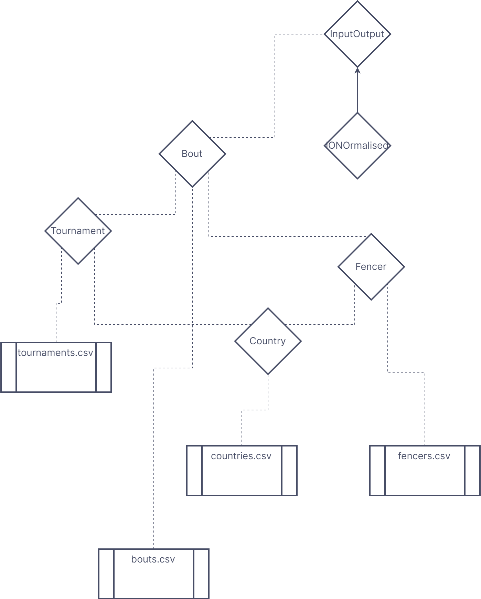

# Introduction: 
This project took data from matches in the poules (or group stages) of women’s Olympic fencing events. 218 tournaments spanning January 2014 to may 2021 were included, totalling almost 50,000 individual matches or bouts. The problem tackled involved taking biographical and bout specific data from this dataset and applying a multivariate linear regression, in order to predict the outcomes of bouts. Error values were computed as well as r^2s.

# Description of the dataset: 
The original data were sourced from a Kaggle dataset which was divided into 4 .CSV files corresponding to biographical data of fencers, historical ranking data for the fencers, details of the tournaments from which the bouts were drawn and the actual bout results themselves, as well as a manually constructed dataset of the countries represented either by athletes or that hosted and event and their corresponding time zones as a decimal difference from GMT.
The Kaggle dataset can be accessed here: ([https://www.kaggle.com/datasets/amichaelsen/fie-fencing-womens-foil-data](https://www.kaggle.com/datasets/amichaelsen/fie-fencing-womens-foil-data))

The dataset of historical ranking data was excluded due to non-homogeneity of the data. Each individual athlete had a variable number of datapoints indicating how well they had ranked in past seasons, as of the collection date of the data. It was outside the scope of this project to implement processing that could handle the inconsistent number of values that would need to be assigned to each Fencer (see section on classes), as well as establishing which rankings to include when considering tournaments that took place in past seasons.

The actual input and output sets were constructed as an array of objects of the constructed class Bout which drew on raw data from the bout data CSV as well biographical and tournament specific data drawn from separate Lists (project). The relationship and class hierarchy is displayed in Figure 1



```
bouts.csv = all_womens_foil_bout_data_May_13_2021_cleaned.csv 
fencers.csv = all_womens_foil_fencer_bio_data_May_13_2021_cleaned.csv
tournaments.csv = all_womens_foil_tournament_data_May_13_2021_cleaned.csv
countries.csv = Countries.csv

```

## Classes and excluded data

A class was made to represent objects in each of the 4 CSV files used, Bout, Fencer, Tournament, Country. Static Lists (project) of these classes were then generated with the StreamReader function. Lists were chosen for this, as iteratively adding each object is more computationally efficient compared to that of arrays.

Due to the hierarchical usage of each class, countries was made first, followed by fencers and tournaments, as each depends on countries, then bouts was constructed as that in turn depends on tournaments and fencers.

### Program class

The Program class was used to house all static methods including the main method, as well as the static lists of objects that were used to hold and process the data.

This class also contained the methods that were used to implement the data randomization and machine learning algorithm.

### Country

The CSV for countries was built manually, by taking the list of countries represented by athletes, or that had hosted a tournament. These objects contained a country code and the full name of the country represented as strings, as well as the difference in time zone between the country and GMT, represented as a double. This data type was chosen instead of the intuitive integer because a number of time zones are in fact fractional, for example Iran uses GMT +3.5.

In cases where multiple time zones exist for a country, the median was taken or that of the mainland in cases where islands account for the alternate zones. Daylight saving time was also ignored for convenience.

101 countries were included in the list.


### Fencer
The biographical data of fencers was taken from one of the CSVs in the Kaggle dataset, containing the information of 2108 athletes. Stored information included ID code, name, country of representation, current age, dominant hand as well as a link to their athlete profile on the official International Fencing Federation website (fie.org)
It was assumed that all athletes live in the country that they represent. Despite the fact this is not always the case, there was no way of obtaining that information so it was left that way for the purposes of the project.
With that considered, a Fencer has the properties:
```c#
	
	public int ID { get; protected set; }
    public bool rightHandDominant { get; protected set; } 
    public Country countryOrigin { get; protected set; }
```
The constructor then takes the list of countries as a parameter, as well as the country index which is derived by comparing the the country id extracted from the CSV and searching the list to find the matching Country. This is done in a static method, within the Program class using the FindIndex Method

### Tournament

The data drawn from the Kaggle dataset were 218 tournaments and included information such as unique identification codes for each event, season and date of the event, categories and hosting country. The data deemed to be pertinent were 
```c#
	
	
	public int Id { get; protected set; } // tournament id

    public string? title { get; protected set; }

    public DateTime startDate { get; protected set; }

    public DateTime endDate { get; protected set; }

    public Country eventCountry { get; protected set; }

    public string category { get; protected set; }

    public string weapon { get; protected set; }

    public bool womens { get; protected set; }

    public string uniqueId { get; protected set; }]
```

the time zone, while present as a string in the CSV file, was not included as this could be derived later from the country.

The constructor worked the same way as with the Fencer class, taking the list of countries as a parameter as well as an index. This time the index was derived by matching the country's full name, rather than the ID, as that was the information present in the CSV.

### Bout
Was the class used to hold information about the individual fencing matches. Bout specific information was taken from the corresponding CSV, the rest was derived from properties of the Fencer and Tournament type properties contained within the Bout class. The bout CSV held data for 49132 bouts.
 ```c#
  
	
	//fencer 1
    public Fencer fencer1 { get; protected set; }  
    public double F1_rightHand { get; protected set; }
    
    public int F1_currentAge { get; protected set; }
    public int F1_score { get; protected set; }
    public double F1_currentRankingPoints { get; protected set; }

    //fencer 2
    public Fencer fencer2 { get; protected set; }
    public double F2_rightHand { get; protected set; }
   
    public int F2_currentAge { get; protected set; }
    public int F2_score { get; protected set; }
    public double F2_currentRankingPoints { get; protected set; }

    //bout
    public int boutWinner { get; protected set; }
    public bool upset { get; protected set; }
    public Tournament tournament { get; protected set; }    
    public DateTime date { get; protected set; }

    //derived properties
    public int delta { get; protected set; }
    public double F1_Timezone_Diff { get; protected set; }
    public double F2_Timezone_Diff { get;protected set; }
    public bool F1_Home { get; protected set; }
    public bool F2_Home { get;protected set; }
```


Similarly to the previous two constructors, the constructor for the Bout class took the lists tournaments and fencers as inputs, as well as indexes for the corresponding fencer1 and fencer2 + tournament. It also performed some minor pre processing by dummy coding the bool `rightHandDominant` to a double of 1 if `true` and 0 if not. This was done so that all properties intended to be used in the regression were in the form of doubles or could be implicitly converted in the case of ints, which is the data type required for the linear regression model to function.

### Pre-processing: 
The first main stage of pre-processing took place in the static methods that built the lists of objects.

#### Static lists
In order to use and operate on the data from the various CSV files, static lists of objects of each aforementioned class type were created. Lists were chosen because it was more computationally efficient to add objects as read line by line from the CSV, than it would be to continuously create new arrays for each additional object.

Each list had a corresponding Static Method in the Program class, which took the filename of a dataset CSV and used the `StreamReader` class to read the CSV file line by line and convert into strings that were delineated by a ',' separator. These strings were then parsed as the appropriate datatype for the value they represented.
Appropriate validation procedures would then be performed to ensure that values were within acceptable ranges (e.g. `F1_currentAge` was within a reasonable range, a Fencer was only right OR left hand dominant, and indexes had been found whenever an object was being located in one of the other lists)
After validation, these new values were used as parameters for the corresponding constructor of whatever class a list was being made of, and the object would then be added to the list.

This process was all contained within a try-catch block, to handle exceptions such as the filename input as the parameter to the static method not being readable or the file not being found.

#### Data separating and processing
Once the critical list bouts had been created, it was necessary to split the data into a separate train and test set for performance validation, first a Fisher-Yates shuffle was used to uniformly randomise the elements in the list, the first n elements of the newly shuffled list were then added to the train set array, and the remainder were copied to the test array, using the `ToArray()` method. Where n was an int property of the Program class, that was initialised as a proportion of the length of the bouts list. The desired ratio between the testing and training set could then be easily modified as desired by adjusting the `trainSize` initiation in the Main method.

The train and test sets were made to be arrays because from this point forward in the program, accessing elements in the collection of bouts would be more frequent and altering the size would not, so to improve computational efficiency, arrays were used.

##### InputOutput class
A new class containing as properties two arrays of type `double[]`, `inputs` and `outputs`. These could then be used as the input and labels for the learning algorithm, the constructor for this class then took the an array of type Bout as a parameter and set the values of `inputs` and `outputs` to appropriate properties. This design choice allowed for very simple and modular creation of inputs and their corresponding labels from any array of bouts. 

So when it came to performing the regression, the training set and testing set were new instances of the InputOutput class.

the elements of each array in `inputs` contained the following
```c#
                
                //fencer 1
                dataset[i].F1_currentAge,
                dataset[i].F1_currentRankingPoints,
                dataset[i].fencer1.countryOrigin.timezone,
                Math.Abs(dataset[i].F1_Timezone_Diff), //takes the magnitude of the difference between timezones instead of the raw value.
                dataset[i].F1_rightHand,                
                
                //fencer 2
                dataset[i].F2_currentAge,
                dataset[i].F2_currentRankingPoints,
                dataset[i].fencer2.countryOrigin.timezone,
                Math.Abs(dataset[i].F2_Timezone_Diff),                 
                dataset[i].F2_rightHand,


                //difference data
                dataset[i].F1_currentAge - dataset[i].F2_currentAge,
                dataset[i].F1_currentRankingPoints - dataset[i].F2_currentRankingPoints,
                dataset[i].F1_Timezone_Diff - dataset[i].F2_Timezone_Diff
```
Where `dataset[i]` is the ith Bout in whichever array of Bouts is being divided.

The `ouputs` contained:
```c#
                dataset[i].F1_score,
                dataset[i].F2_score,
                dataset[i].delta
```
which are the scores of each individual athletes in the bout, and the difference between those scores.

An earlier version of the constructor for this class, applied normalisation techniques to each individual instance in `inputs`, essentially normalising input values within each bout. This is theoretically an incorrect approach, however as discussed in the Conclusion section, the implementation showed performance improvement so the code as been left commented out for the examiner's interest.

###### IONormalised Class
IONormalised was a subclass of InputOutput which inherited the same properties `inputs` and `outputs`, as well as using the following column-wise statistical properties to perform normalisation on the input data
```c#
    public int numRows { get; protected set; }
    public int numCols { get; protected set; }   
    public double[] columnMeans { get; protected set; }
    public double[] columnStdDevs { get; protected set; }
    public double[] columnMins { get; protected set; }
    public double[] columnMaxs { get; protected set; }
```

The main difference was the constructor took as an additional parameter a string describing a normalisation method to be applied. This avoided the repetition of could that would have been necessary to use method overloading and creating a separate constructor for the InputOutput class.

New instances of the IONormalised class could then declare if and what kind of normalisation method should be applied to the inputs, Min-Max or Standardisation. A simple if-else chain was used to check if the `normMethod` string parameter matched either "MinMax" or "Standard" and applied that normalisation technique. If `normMethod` did not match or was equal to "None", then no normalisation would be applied and the constructor would function exactly the same as the constructor for the InputOutput class.

The actual normalisation process made use of a for loop that operated column-wise using and calculating the corresponding new properties, and then used those to apply normalisation.
The reason these were made to be properties and not simply declared within the constructor is so that they could later be used by the overridden method `PrintIO()`

## Model Description: 
The chosen model for this project was  multivariate linear regression. It is a generalisation of the multiple linear regression, which is in turn a generalisation of the simple linear regression. Linear regression was chosen because the desired output was numerical so regression was most appropriate compared to classification, and it was labelled data so clustering was not appropriate. The multivariate variation was selected because multiple input values were used. It could have been possible to perform the regression with only 1 output variable, representing the delta between the scores of each fencer representing the outcome of the match, in a range of -9 to +9, as poule matches are concluded by the winner reaching 5 points. However it is also possible for matches to end on "time", thus the outcome of 3-2 would be represented the same as 5-4 when only delta was predicted. Therefore two more output variables representing each individual athlete's score in the match were also used as output to be predicted.

An ordinary least squares learning algorithm was used to compute the linear coefficient for each input element that lead to the best prediction of each of the 3 output values. i.e. the best solutions to the equations:
```
a1x1 + a2x2 ... anxn = o1
b1x1 + b2x2 ... bnxn = o2
c1x1 + c2x2 ... cnxn = o2
```
where `ai, bi, ci` are linear coefficients of the `xi` input element, and `o1, o2 and o3` are the output values (f1_score, f2_score and delta)
### Accord Library Usage:

#### OrdinaryLeastSquares:
The OrdinaryLeastSquares class is a part of the Accord.Math namespace. It provides functionality for performing ordinary least squares linear regression. This method fits a linear model to the given data using the least squares approach, estimating the coefficients for the linear equation. It is commonly used for linear regression problems where the relationship between the input features and the output variable is assumed to be linear.
#### MultivariateLinearRegression:
The MultivariateLinearRegression class is also part of the Accord.Math namespace. It extends the functionality of linear regression to handle multiple input features. It can be used when the relationship between the input features and the output variable is assumed to be linear but with multiple input variables.
#### SquareLoss:
The SquareLoss class is used to calculate the squared loss, also known as mean squared error (MSE), which is a common loss function used in regression problems. It measures the average squared difference between the predicted and actual values. The SquareLoss class is part of the Accord.MachineLearning namespace and can be used to evaluate the performance of regression models.


# Use of Object Oriented Programming techniques:

## Inheritance
One instance of inheritance was used, in the case of the IONormalised class. This usage is justified in the dedicated section of the report. Aside from this example, no suitable "is a" relations existed among the data for class inheritance to be useful

## Contains/Uses
While "is a" relations were sparse, "uses" relations were very frequent, as the classes were arranged in a structure that used objects from the other classes frequently.

Fencer uses an instance of Country, Bout uses 2 instance of Fencer and one of Tournament.

## Interfaces
Just as there was no large need for inheritance, interfaces were also of no great use in this project, so were not implemented.

## Static Classes/Methods/Variables
Static methods, and Static lists played a large roll in this project, as the majority of classes and their constructors relied on accessing specific instances of other classes, which were subsequently stored in static lists for said access.

Static methods were implemented to read from the corresponding CSVs and add to the aforementioned static lists, as this was not an action performed on individual instances of each class, the methods being static was appropriate.

## Method Overloading
As the project was operating with an already understood and fixed dataset, and machine learning models with specific input necessities, there was no use for method overloading to account for different data types or variable numbers of parameters.

## Method overriding and polymorphism
Due to the lack of class hierarchy in this project, there was only one implementation of method overriding, in the case of the `PrintIO()` method, as described in the section on the IONormalised Class.
# Searching and Sorting efficiency
Two main searching or sorting tasks were utilised in this project, `FindIndex()` method which was used in each of the static methods to identify the index of an object such as a Fencer in the list `fencers` when calling an instance in the Bout constuctor
The second was the Fisher-Yates shuffle algorithm used to randomise the final list `bouts` before dividing it into the test and train sets.

Both of these tasks have a worst case computational complexity of O(n) where n is the number of elements in the given list. As `FindIndex()` may have to search the entire list before finding an index, or if the item is not present, and the Fisher-Yates shuffle algorithm must iterate through the entire length of the list.

# Results: 
Various metrics were used to assess the performance of the ML model on the test dataset. 
results.
A square loss was calculated between the predicted values and the true values, and an r^2 was calculated for each output value. An adjusted r^2 was also calculated, which accounted for overfitting due to the large number of independent input variables used. These values were also compared to the same statistics, calculated on the training set, to asses for further overfitting.

## On a clean run of the program, with no normalisation applied results such as the following were typical:
```
Learned intercepts of regression:
3.448438284690455
3.43330856265326
0.015129722037189083
Learned coefficients of regression:
column: 0
2002282496.2226694
1488481323.4663572
513801172.75484765
column: 1
-4462721995.764399
4883225342.224488
-9345947337.998846
column: 2
24571128691.675644
-17583454721.422367
42154583413.09636
column: 3
0.028770780276621916
-0.022570411377738388
0.05134107222968194
column: 4
-0.21274887388535987
0.24432074717624608
-0.45706642397463143
column: 5
-2002282496.2250838
-1488481323.4674025
-513801172.7562176
column: 6
4462721995.763836
-4883225342.224362
9345947337.998156
column: 7
-24571128691.66665
17583454721.41372
-42154583413.0787
column: 8
-0.01815010647384263
0.024526195172379552
-0.04267630164622192
column: 9
0.2297337980050984
-0.23855389181879325
0.46828768982388225
column: 10
-2002282496.2108047
-1488481323.4805708
-513801172.7287708
column: 11
4462721995.782502
-4883225342.243168
9345947338.03563
column: 12
-24571128691.671135
17583454721.418716
-42154583413.08819
*** Performance on train set ***
error: 14.839928899406763
r2s on training data
0.10418415614470333
0.10763409039513627
0.12828156209361607
alternative r2s on train data
0.10388768696188933
0.10733876296393896
0.12799306791849885
*** Performance on test set ***
error: 14.839766254967714
r2s on test data
0.10565596416120715
0.10058199650091704
0.12508762064855938
alternative r2s on test data
0.10447079877222609
0.09939010719964403
0.12392820567082552
```
The first concern is the wide range in magnitude of the coefficients for each column (input variable), considering the fact that the maximum value of any input value without normalisation is in the order of hundreds and the outputs cannot be outside the magnitude of 9.
The next is that the least squared error values are consistently in the range of 15, on it's own this cannot be interpreted but when coupled with the coefficient of determination values (r2s) that average around 0.1 for the individual score predictions and 0.12 for the delta predictions, it indicates a poor fit of the model, with r2 = 1 being the goal.

##  With normalisation:
It was though that normalising the data in some way would improve performance, as some input values range from 0 to 1 in the case of handedness, and from 0 to 311 in the case of ranking points.
Two different normalisation techniques were applied. This normalisation takes place after the randomisation, so while applied one after the other, they are applied to the same test and train sets. 
### Standardisation:
```
Learned intercepts of regression:
3.4432198167242407
3.4073241620867742
0.03589565463747472
Learned coefficients of regression:
column: 0
-20921310232.31984
92756932214.08446
-113678242446.38449
column: 1
346025197455.062
-1042018107258.7587
1388043304710.6748
column: 2
-68668364731.27559
-43377206013.05798
-25291158718.211132
column: 3
0.09500684272351258
-0.07428689192857191
0.16929661216212089
column: 4
-0.08435836268508123
0.09727028666756478
-0.1816307395751905
column: 5
20926120656.33644
-92778259758.64124
113704380414.95786
column: 6
-346483914438.63214
1043399484703.2244
-1389883399138.7063
column: 7
68911461296.51334
43530767989.22907
25380693307.27777
column: 8
-0.06089327597215148
0.08223356719366844
-0.14312684316582105
column: 9
0.09179961050481623
-0.09524732804248337
0.1870469385473009
column: 10
14863005614.727585
-65896771712.14234
80759777326.85582
column: 11
-460732573202.40894
1387447178448.6904
-1848179751646.9104
column: 12
89138302141.6975
56307886619.778
32830415521.911102
*** Performance on train set ***
error: 14.839099612273113
r2s on training data
0.10428765599329681
0.10761136026706064
0.12833632874023482
alternative r2s on train data
0.10399122106363401
0.1073160253133546
0.1280478526900738
*** Performance on test set ***
error: 7.221321487916447E+21
r2s on test data
-8.867188165553319E+19
-7.730895169062272E+20
-4.254765942404436E+20
alternative r2s on test data
-8.878938771685042E+19
-7.741139984271019E+20
-4.2604042662832597E+20
```

#### Min-Max normalization:
```
Learned intercepts of regression:
177465352077.61215
-75543341739.53821
253008693817.01047
Learned coefficients of regression:
column: 0
1961299257640.5718
-948869405085.6127
2910168662722.43
column: 1
-865193374011.871
607953368254.8441
-1473146742263.8184
column: 2
-129521208696.57355
-143259681142.50458
13738472444.982279
column: 3
0.44602501819197127
-0.35016311888810453
0.796186702538945
column: 4
-0.1980006969034918
0.23199733326794011
-0.4300192515424459
column: 5
-1961299257640.678
948869405085.4972
-2910168662722.42
column: 6
865193374011.9803
-607953368255.0564
1473146742264.1394
column: 7
129521208696.74046
143259681142.35513
-13738472444.665865
column: 8
-0.2805388851855696
0.3797887306180645
-0.6603248059018823
column: 9
0.24097223903674833
-0.24449522498757797
0.48553565084918104
column: 10
-2391173067533.275
1156840781541.429
-3548013849070.1255
column: 11
1675442795827.0024
-1177298765386.2507
2852741561207.6426
column: 12
213991562194.34744
236689907974.54108
-22698345778.625782
*** Performance on train set ***
error: 14.839613273826506
r2s on training data
0.10418586214190706
0.10766274250308572
0.12830237618406637
alternative r2s on train data
0.10388939352369086
0.10736742455426929
0.12801388889734744
*** Performance on test set ***
error: 2.2112049544420246E+21
r2s on test data
-2.137360780655072E+20
-5.625618069067855E+19
-1.3038969436452902E+20
alternative r2s on test data
-2.1401931649719442E+20
-5.633073016559994E+19
-1.3056248396970118E+20
```
For both techniques performance on the training set remained the same as without normalisation, however performance on the test set produced outputs for r2 outside the mathematical range of -1 to +1.

The results for both of these are both so absurdly outside the range of possible values, it is likely that features of the data caused extreme overfitting. The implications are further discussed in the Conclusion section.

# Conclusion: 
Based on the evaluation of the results, it is clear that the model was an inappropriate fit for the data. It is likely that if any deeper relationship exists between the input variables and the outcomes of a fencing match it is not linear. Furthermore, normalisation attempts worsened the performance of the model when tested on the test set. 
One explanation for this is that the when the input variables were made homogenous certain inputs gained a greater influence relative on the model leading to overfitting. I.e. in the unnormalized data the model was biased towards the features with larger values, which just so happened to be better predictors of the outcomes, when this bias was removed through normalisation the model was unduly influenced by the less important variables leading to overfitting.

Interestingly it was found during previously mistaken normalisation attempts, in which values were normalised within each instance of a Bout, performance was marginally improved. An example of results using MIn-Max normalisation is shown below:

```
Learned intercepts of regression:
2.8386407516402357
3.4449552357150557
-0.6063144840747916
Learned coefficients of regression:
column: 0
-490309571271.2738
342676969740.2262
-832986541010.6102
column: 1
667731903158.2432
-379018518394.8499
1046750421553.0127
column: 2
-177422331884.87332
36341548654.21922
-213763880539.90192
column: 3
0.46479017501111786
-0.34107961400668685
0.8058013511444946
column: 4
-2.962187043940593
3.8902088979166725
-6.851836520759815
column: 5
490309571271.57654
-342676969740.4277
832986541011.1145
column: 6
-667731903158.1964
379018518395.1214
-1046750421553.2377
column: 7
177422331884.80914
-36341548654.30447
213763880539.92288
column: 8
-0.12312307729318477
0.4017155918438844
-0.5248368067131962
column: 9
3.4325909264568986
-3.4279165582108746
6.860647018048251
column: 10
490309571271.63983
-342676969740.64325
832986541011.3931
column: 11
-667731903157.4163
379018518393.9816
-1046750421551.3174
column: 12
177422331884.6729
-36341548654.20621
213763880539.68842
*** Performance on train set ***
error: 14.0255727809691
r2s on training data
0.14216201556491503
0.15381865237758874
0.17818169574724663
alternative r2s on train data
0.14187811510928372
0.1535386096719782
0.17790971596171967
*** Performance on test set ***
error: 14.194868206071268
r2s on test data
0.14022865874889479
0.14466860905278267
0.17152311831329636
alternative r2s on test data
0.13908930834764455
0.14353514237772513
0.17042523865356884
```
These results for r2 are still not as close to 1 as would be desired, but are visibly better than those on the unnormalized data .

This is possibly because outcomes, as well as not being linearly related to the input data, were also more dependent on relative values of inputs within each bout rather than absolute values.

However when comparative measures of features thought to be important in this regard (Age, Ranking points and Time zone difference) were included and tested instead of the raw values, no significant improvement in performance was observed.

A positive observation is that aside from the theoretically correct normalisation techniques, the performance on the test set was almost identical to that of the train set, suggesting that under normal circumstances, overfitting is not occurring.

## Alternative Models
While the linear regression model may not have performed well on the data, it is not necessarily true that no pattern exists. A visual inspection of a sample output prediction compared to the true values suggests that a classification model such as logistic regression would have faired better.
```
Predicted values for a sample of 5 bouts
Bout 0:
3.5760392496074047      3.2221881350320913      0.3538740027589051
Bout 1:
3.7432450601542797      3.1483527621072867      0.5950086463135926
Bout 2:
3.2059220621074047      3.6890889605325796      -0.4830934655028136
Bout 3:
4.255349094578108       2.5104006727975943      1.7447965491456239
Bout 4:
3.0616959878886547      3.876629968528185       -0.8149339806395324
actual result 0:
2       5       -3
actual result 1:
5       2       3
actual result 2:
1       5       -4
actual result 3:
5       0       5
actual result 4:
0       5       -5
```
While not statistically rigorous, the fact the model predicted the sign of delta correctly 4/5 times suggests there is potential for a classification based model to be used on the data. This avenue was not initially pursued in hopes of achieving the more subjectively interesting result of predicting the entire outcome of a bout, but it is likely that the noise of the data makes this nearly impossible with the statistical models at hand.


# References: 
Abu-Mostafa, Y., Magdon-Ismail, M., & Lin, H.-T. (2012). _Learning From Data: A Short Course_. AMLbook.com.

Eberl, M. (2016). Fisher–Yates shuffle. _Archive of Formal Proofs_. [https://www.isa-afp.org/entries/Fisher_Yates.html](https://www.isa-afp.org/entries/Fisher_Yates.html)
List of time zones by country. (2023). In _Wikipedia_. [https://en.wikipedia.org/w/index.php?title=List_of_time_zones_by_country&oldid=1153472282](https://en.wikipedia.org/w/index.php?title=List_of_time_zones_by_country&oldid=1153472282)

Mohri, M., Rostamizadeh, A., & Talwalkar, A. (2018). _Foundations of Machine Learning_. The MIT Press. [https://mitpress.mit.edu/9780262039406/foundations-of-machine-learning/](https://mitpress.mit.edu/9780262039406/foundations-of-machine-learning/)

Osborne, J. W., & Waters, E. (2002). Four assumptions of multiple regression that researchers should always test. _PracticalAssessment,Research,AndEvaluation_, _8_. [https://doi.org/10.7275/R222-HV23](https://doi.org/10.7275/R222-HV23)

PAGEAUD, A. (n.d.). _FIE Fencing Womens Foil Data_. Retrieved 14 March 2023, from [https://www.kaggle.com/datasets/amichaelsen/fie-fencing-womens-foil-data](https://www.kaggle.com/datasets/amichaelsen/fie-fencing-womens-foil-data)
